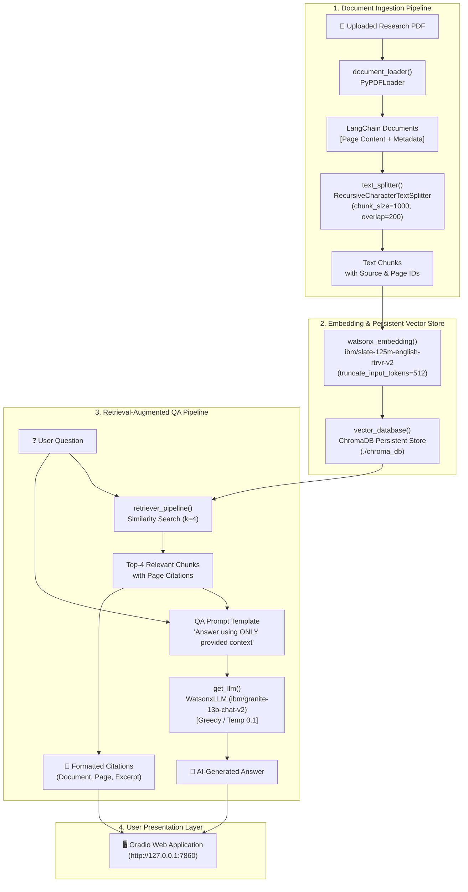

# PDF Research Assistant – RAG QA Bot

[](https://www.python.org/downloads/)
[](https://python.langchain.com/)
[](https://www.ibm.com/watsonx)
[](https://www.trychroma.com/)
[](https://gradio.app/)
[](https://opensource.org/licenses/MIT)

A fully functional, beginner-friendly **Retrieval-Augmented Generation (RAG)** application implementing the assignment:  
**"Construct a QA Bot that Leverages LangChain and an LLM to Answer Questions from Loaded Documents."**

---

## 1. Project Overview

The **PDF Research Assistant – RAG QA Bot** enables researchers, students, and engineers to upload technical PDF documents, extract and chunk text, generate semantic embeddings, store them in a persistent local vector database, and perform high-precision question answering powered by IBM watsonx.ai foundation models.

The system enforces strict context constraints to prevent AI hallucination, citing the exact document name, page number, and source text for every answer.

### Key Capabilities
- **Robust PDF Parsing:** Extracts text and page metadata using `PyPDFLoader` with validation for empty, corrupted, or non-text files.
- **Recursive Text Chunking:** Splits text with `RecursiveCharacterTextSplitter` (1000 chunk size, 200 overlap) while preserving page tracking.
- **Dense Vector Embeddings:** Uses IBM's `ibm/slate-125m-english-rtrvr-v2` dense retrieval embedding model with token truncation.
- **Persistent ChromaDB Vector Store:** Local on-disk persistence (`./chroma_db`) with deterministic chunk hashing to eliminate duplicate embeddings.
- **Similarity Search Retriever:** Retrieves top-4 most relevant chunks via cosine/dot similarity.
- **Factual Question Answering:** Powered by IBM watsonx.ai instruction-tuned models (default: `ibm/granite-13b-chat-v2`) with greedy decoding.
- **Modern Gradio Interface:** Clean, responsive UI with real-time status feedback, source citation cards, and session clearing.

---

## 2. Architecture Diagram



---

## 3. Technology Stack

| Component | Library / Service | Purpose |
| :--- | :--- | :--- |
| **Runtime** | Python 3.11 | Core execution environment |
| **Orchestration** | LangChain & LangChain-Classic | End-to-end RAG chain construction (`RetrievalQA`) |
| **Embeddings** | `langchain-ibm` (`ibm/slate-125m-english-rtrvr-v2`) | High-density semantic document representations |
| **LLM** | `langchain-ibm` (`ibm/granite-13b-chat-v2`) | Factual instruction-following question answering |
| **Vector Database** | ChromaDB (`langchain-chroma`) | Persistent local similarity index |
| **PDF Extraction** | PyPDF (`pypdf`, `langchain-community`) | Multi-page text and metadata extraction |
| **UI Framework** | Gradio 6 | Interactive web interface |
| **Configuration** | `python-dotenv` | Secure API credential management |
| **Testing** | `pytest` | Automated unit and integration test suite |

---

## 4. Project Directory Structure

```text
rag-qa-bot/
│
├── app.py                      # Main Gradio application entry point
├── requirements.txt            # Tested, pinned dependency specifications
├── .env.example                # Template for IBM watsonx credentials
├── .gitignore                  # Git ignore rules for venv, DB, and secrets
├── pytest.ini                  # Pytest configuration and pythonpath
├── README.md                   # Complete beginner-friendly documentation
│
├── agents/
│   ├── __init__.py             # Agent package exports
│   └── qa_agent.py             # RAG chain, QA prompt, citation formatter
│
├── utils/
│   ├── __init__.py             # Utilities package exports
│   ├── document_loader.py      # PyPDFLoader wrapper with validation
│   ├── text_splitter.py        # Recursive text chunking
│   ├── embeddings.py           # IBM slate-125m embedding connector
│   ├── vector_store.py         # Persistent Chroma vector store & deduplication
│   ├── retriever.py            # End-to-end retriever assembly
│   └── llm.py                  # IBM granite LLM connector
│
├── data/
│   ├── sample_research_paper.pdf # Included academic sample paper for testing
│   └── uploads/                # Directory for uploaded user documents
│
├── chroma_db/                  # Persistent local Chroma vector database
│
├── screenshots/
│   ├── README.md               # Guidelines for assignment screenshot
│   └── QA_bot.png              # Required evaluation screenshot
│
└── tests/
    ├── __init__.py             # Tests package
    └── test_pipeline.py        # 21 comprehensive unit & integration tests
```

---

## 5. IBM watsonx.ai Credential Setup

To use live IBM watsonx.ai foundation models, you will need an active IBM Cloud account and watsonx.ai project:

### Step 1: Create an IBM Cloud API Key
1. Log in to your [IBM Cloud Console](https://cloud.ibm.com/).
2. Navigate to **Manage** -> **Access (IAM)** -> **API keys**.
3. Click **Create an IBM Cloud API key**.
4. Name your key (e.g., `watsonx-rag-key`), copy the generated secret key, and save it safely.

### Step 2: Obtain Your watsonx.ai Project ID
1. Open [IBM watsonx.ai](https://dataplatform.cloud.ibm.com/wx/home).
2. Open or create a project (e.g., `PDF-Research-Assistant`).
3. Click the **Manage** tab in the top navigation bar.
4. Select the **General** section from the left menu.
5. Copy the **Project ID** (a UUID string like `12345678-abcd-ef01-2345-6789abcdef01`).

### Step 3: Identify Your Service URL
Depending on your data center region:
- **Dallas (us-south):** `https://us-south.ml.cloud.ibm.com`
- **Frankfurt (eu-de):** `https://eu-de.ml.cloud.ibm.com`
- **Tokyo (jp-tok):** `https://jp-tok.ml.cloud.ibm.com`
- **London (eu-gb):** `https://eu-gb.ml.cloud.ibm.com`

---

## 6. Environment Configuration

1. Create a `.env` file in the project root by copying `.env.example`:
   ```powershell
   Copy-Item .env.example .env
   ```
2. Open `.env` and fill in your credentials:
   ```env
   WATSONX_APIKEY=your_actual_api_key_here
   WATSONX_PROJECT_ID=your_actual_project_id_here
   WATSONX_URL=https://us-south.ml.cloud.ibm.com
   WATSONX_EMBEDDING_MODEL_ID=ibm/slate-125m-english-rtrvr-v2
   WATSONX_LLM_MODEL_ID=ibm/granite-13b-chat-v2
   ```

> [!IMPORTANT]
> Never commit your `.env` file to version control. The `.gitignore` file is configured to protect your credentials.

---

## 7. Installation & Execution Instructions

Run the following commands in **Windows PowerShell**:

### 1. Clone or Open the Repository
```powershell
cd "c:\Users\SINDHU SURAJ\source\repos\RAG-based PDF Question Answering Bot"
```

### 2. Create the Virtual Environment (Python 3.11)
```powershell
py -3.11 -m venv .venv
```

### 3. Activate the Virtual Environment
```powershell
.\.venv\Scripts\Activate.ps1
```
*(If PowerShell restricts script execution, run `Set-ExecutionPolicy -ExecutionPolicy RemoteSigned -Scope Process` first).*

### 4. Install Dependencies
```powershell
pip install -r requirements.txt
```

### 5. Run the Application
```powershell
python app.py
```

The Gradio web interface will launch locally at:
👉 **`http://127.0.0.1:7860`**

Open this URL in any web browser.

---

## 8. Example Questions & Walkthrough

You can test the application using the included research paper (`data/sample_research_paper.pdf`):

1. **Upload:** Drag and drop `data/sample_research_paper.pdf` into the upload box.
2. **Status:** Wait for `✅ Document processed successfully (3 pages extracted and indexed)`.
3. **Ask Questions:**
   - *"What is the main architecture proposed in this paper?"*
     > **Expected Answer:** The paper proposes the Transformer, an encoder-decoder architecture based entirely on self-attention mechanisms without sequence-aligned recurrent or convolutional networks.
   - *"What BLEU score did the model achieve on WMT 2014 English-to-German?"*
     > **Expected Answer:** The Transformer achieved a state-of-the-art BLEU score of 28.4 on the WMT 2014 English-to-German translation task.
   - *"What are the advantages of Multi-Head Attention?"*
     > **Expected Answer:** Multi-head attention allows the model to jointly attend to information from different representation subspaces at different positions.
   - *"What is the recipe for chocolate cake?"*
     > **Expected Answer:** The provided document does not contain information about a recipe for chocolate cake. (Demonstrates strict non-hallucination constraint).

---

## 9. Automated Testing Suite

The repository includes 21 comprehensive unit and integration tests covering all pipeline stages. External API calls are mocked so unit tests run completely offline without incurring cloud usage or requiring active credentials:

```powershell
.\.venv\Scripts\Activate.ps1
pytest -v
```

### What the Test Suite Verifies:
- **`TestDocumentLoader`:** PDF ingestion, missing file errors, invalid extensions, 0-byte PDFs, corrupt headers, Gradio file object compatibility.
- **`TestTextSplitter`:** Chunk boundaries, chunk overlap constraints, metadata preservation (`source`, `page`, `chunk_index`).
- **`TestEmbeddings`:** Slate-125m model ID, input token truncation params, credential validation errors.
- **`TestVectorStore`:** Persistent Chroma initialization, deterministic chunk hash deduplication, collection name sanitization.
- **`TestRetrieverPipeline`:** 5-step pipeline execution, top-4 similarity search retrieval.
- **`TestLLMConfiguration`:** WatsonxLLM parameters (`greedy`, low temperature, factual generation).
- **`TestQuestionAnsweringAgent`:** Custom prompt constraint verification, `RetrievalQA` execution, source citation formatting, empty query handling.

---

## 10. Capturing the Assignment Screenshot (`QA_bot.png`)

The assignment requires saving a screenshot of the running interface to:
`screenshots/QA_bot.png`

### Requirements Checklist for `QA_bot.png`:
The screenshot must show all of the following visible together in one frame:
- [x] Application title: **PDF Research Assistant – RAG QA Bot**
- [x] Uploaded PDF filename: (e.g., `sample_research_paper.pdf`)
- [x] Document processing success message: `✅ Document processed successfully.`
- [x] User's question: (e.g., `What is the core architecture introduced in this research?`)
- [x] AI-generated answer: Retrieved factual response.
- [x] Source reference: Citation displaying document name, page number, and text excerpt.

See [screenshots/README.md](file:///c:/Users/SINDHU%20SURAJ/source/repos/RAG-based%20PDF%20Question%20Answering%20Bot/screenshots/README.md) for full capture instructions.

---

## 11. Troubleshooting Guide

| Issue | Root Cause | Solution |
| :--- | :--- | :--- |
| **`Missing required IBM watsonx.ai credentials`** | `.env` file does not exist or variables are blank | Copy `.env.example` to `.env` and fill in `WATSONX_APIKEY`, `WATSONX_PROJECT_ID`, and `WATSONX_URL`. For offline testing, check the **Enable Offline Mock Mode** box in the UI. |
| **`ExecutionPolicy error in PowerShell`** | Windows blocks PowerShell scripts by default | Run `Set-ExecutionPolicy -ExecutionPolicy RemoteSigned -Scope Process` in your PowerShell terminal. |
| **`The file is not a valid PDF document`** | File missing `%PDF-` header or has wrong format | Ensure the file is an authentic text-based PDF file. |
| **`The PDF contains no extractable text`** | PDF is a scanned image with no OCR layer | Run OCR on the document or upload a digital-native text PDF. |
| **`Port 7860 already in use`** | Another Gradio app is running on port 7860 | Specify an alternate port in `app.py` (e.g., `demo.launch(server_port=7861)`). |

---

## 12. License

This project is created for educational and academic assessment purposes under the MIT License.
